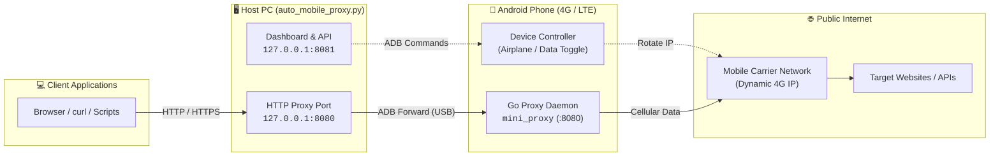

[ English ](README.md) · [ Tiếng Việt ](README.vi.md)

# 4G Mobile Proxy

[](LICENSE)
[](https://www.python.org/)
[](https://nodejs.org/)
[](#requirements)
[](#how-it-works)
[](#requirements)

> **Turn your 4G Android phone into a high-performance rotating HTTP proxy on PC via ADB. Zero APK, no root required, with a modern local web dashboard.**

4G Mobile Proxy turns an ordinary Android phone with a 4G/LTE SIM into an HTTP proxy for your computer. The phone is controlled entirely over ADB: a small Go daemon is copied to `/data/local/tmp`, an ADB port forward exposes it as `127.0.0.1:8080`, and a Python service provides a local web dashboard at `127.0.0.1:8081` for monitoring, rotating IPs, and managing the device.

The dashboard and backend logs are fully bilingual (English and Vietnamese), with English as the default language.

## Table of Contents

- [Features](#features)
- [How It Works](#how-it-works)
- [Requirements](#requirements)
- [Quick Start](#quick-start)
- [Demo Mode](#demo-mode)
- [Command-Line Options](#command-line-options)
- [Console Commands](#console-commands)
- [Dashboard](#dashboard)
- [REST API](#rest-api)
- [Configuration and Data](#configuration-and-data)
- [Project Structure](#project-structure)
- [Development](#development)
- [Testing](#testing)
- [Troubleshooting](#troubleshooting)
- [Security](#security)
- [Contributing](#contributing)
- [License](#license)
- [Repository Metadata & Recommended GitHub Topics/Tags](#repository-metadata--recommended-github-topicstags)

## Features

- **Zero APK, no root required.** The proxy daemon is a static Go binary pushed to `/data/local/tmp/mini_proxy`; nothing is installed as an Android app. Root is optional and only unlocks hardware-level battery charge cutoff.
- **Rotating HTTP proxy.** Supports plain HTTP and HTTPS via `CONNECT`, with a resolver on the phone so DNS lookups use the mobile network.
- **Manual or scheduled rotation.** Rotate on demand, or automatically every 2–1440 minutes using airplane mode or a mobile-data toggle.
- **Live network monitoring.** Public IP, ISP, city/region/country, latency, and step-by-step rotation progress.
- **Modern local dashboard.** Five responsive pages built with React 19, TypeScript, Vite 7, and Tailwind CSS v4.
- **English and Vietnamese UI.** A flag-based language switcher in the topbar (and mobile quick actions) persists the choice in `settings.json`. Backend event logs are localized too.
- **4G data usage tracking.** Reads traffic counters from the phone, accumulates daily usage, and warns when a configurable daily limit is reached.
- **Battery and thermal protection.** Shows battery level, temperature, health, voltage, and charging state. Pauses charging automatically at critical temperatures (root enables hardware cutoff).
- **Local history and logs.** Keeps the last 100 rotations and 500 log lines under `data/` (git-ignored).
- **Demo mode.** Explore the entire dashboard with simulated devices and IPs, without a phone.
- **Loopback-first security.** The dashboard binds to `127.0.0.1` by default, sends a strict CSP, and keeps settings and history on your machine.

## How It Works



1. The Python application discovers the phone with `adb devices`.
2. It selects the matching ARM32 or ARM64 daemon from `backend/bin/` and pushes it to `/data/local/tmp/mini_proxy`.
3. The daemon starts on the phone, and `adb forward` maps PC port `8080` to the same port on the device.
4. Applications on the PC send traffic to `127.0.0.1:8080`; the daemon forwards it over the phone's 4G/LTE connection.
5. To rotate the IP, the service toggles airplane mode or mobile data, waits for the carrier to reconnect, and verifies the new public IP.
6. The dashboard and JSON API on `127.0.0.1:8081` control the device and display live state.

## Requirements

| Component | Requirement |
| --- | --- |
| Operating system | Windows 10/11, macOS 12+, or Linux (Ubuntu, Debian, Fedora, etc.) |
| Python | **3.11+** with `pip` |
| Node.js | **20+** with npm (only needed to build or develop the dashboard) |
| Android Platform Tools | `adb` available in `PATH` (or detected in standard SDK directories) |
| Phone | Android device with USB debugging enabled, a USB cable, and an active 4G/LTE SIM |
| Root | **Not required.** Optional for hardware-level charge cutoff |

### Platform Notes & ADB Setup

- **Windows:** Download Android Platform Tools or install via Android Studio. If your device isn't recognized, install OEM / Google USB drivers in Device Manager.
- **macOS:** Install with Homebrew: `brew install android-platform-tools`. *Note:* Quit background file transfer apps (*Android File Transfer*, *Samsung Smart Switch*, *OpenMTP*) as they lock the USB interface.
- **Linux:** Install via package manager: `sudo apt install adb android-sdk-platform-tools-common`. Add your user to the `plugdev` group (`sudo usermod -aG plugdev $USER`) and re-plug USB to avoid `no permissions` udev errors.

Install the Python dependency:

```bash
python -m pip install -r requirements.txt
```

> The dashboard is served from `frontend/dist`, which is not committed. Build it once after cloning (see [Quick Start](#quick-start)).

## Quick Start

### 1. Clone the repository

```bash
git clone https://github.com/dznpev/Proxy-4GMobile.git
cd Proxy-4GMobile
python -m pip install -r requirements.txt
```

### 2. Prepare the phone

1. Enable **Developer options** (tap **Build number** seven times in **About phone**).
2. Turn on **USB debugging**.
3. Connect the phone by USB and accept the **Allow USB debugging** prompt. Choose **Always allow from this computer** for convenience.
4. Verify the connection:

```bash
adb devices
# The phone must appear with status "device", not "unauthorized" or "offline".
```

### 3. Build the dashboard

```bash
cd frontend
npm install
npm run build
cd ..
```

### 4. Run

```bash
python auto_mobile_proxy.py --open
```

- Dashboard: **http://127.0.0.1:8081**
- HTTP proxy: **http://127.0.0.1:8080**

Point your browser, OS, or tool at the proxy and verify the exit IP:

```bash
curl -x http://127.0.0.1:8080 https://api.ipify.org
```

On first launch the app detects the phone, starts the daemon, and opens a proxy session. Use the dashboard to rotate the IP, change settings, or inspect the device.

## Demo Mode

Demo mode simulates a connected device, public IPs, rotation progress, battery data, and logs. It is useful for UI development, screenshots, and trying the workflow without an Android phone:

```bash
python auto_mobile_proxy.py --demo --open
```

The dashboard is still available at `http://127.0.0.1:8081`, and the demo state is clearly marked in the UI and `/api/health`.

## Command-Line Options

| Option | Default | Description |
| --- | --- | --- |
| `--demo` | off | Simulate the device, IP, and rotation progress. |
| `--proxy-port` | `8080` | Local HTTP proxy port. |
| `--control-port` | `8081` | Dashboard and JSON API port. |
| `--host` | `127.0.0.1` | Dashboard bind address. Change only if you understand the security risk. |
| `--adb` | `adb` | Path to the ADB executable. |
| `--data-dir` | `data/` | Directory for `settings.json`, `history.json`, and `usage.json`. |
| `--headless` | off | Do not read keyboard commands; run the dashboard and background service only. |
| `--open` | off | Open the dashboard in the default browser. |
| `--version` | - | Print the application version and exit. |

Environment variables are also supported:

| Variable | Default | Description |
| --- | --- | --- |
| `PROXY_HTTP_PORT` | `8080` | Local HTTP proxy port. |
| `PROXY_CONTROL_PORT` | `8081` | Dashboard and API port. |
| `PROXY_CONTROL_HOST` | `127.0.0.1` | Dashboard bind address. |
| `PROXY_DATA_DIR` | `data/` | Data directory. |
| `PROXY_ADB` | `adb` | Path to the ADB executable. |

CLI flags take precedence over environment variables.

## Console Commands

When running interactively (without `--headless`):

| Command | Action |
| --- | --- |
| `r` | Start an IP rotation. |
| `c` | Re-check the connection and public IP. |
| `h` or `?` | Show help. |
| `q` | Quit and clean up the daemon on the phone. |

## Dashboard

| Page | Contents |
| --- | --- |
| **Overview** | Session status, current IP and carrier, rotation progress, usage statistics, recent history, and recent logs. |
| **Device** | Serial, model, Android version, ABI, root status, ADB state, daemon state, port forwarding, battery and temperature controls, reconnect, and daemon restart. |
| **IP History** | Full rotation table with success/failure filters, timestamps, old/new IPs, ISP, location, duration, and clear-history action. |
| **Logs** | The latest 500 log lines with severity filters, search, auto-scroll, and clear action. |
| **Settings** | Automatic rotation, interval, rotation method, daily data limit, display language, API endpoints, and data directory. |

The interface uses hash routing (`#/overview`, `#/device`, `#/history`, `#/logs`, `#/settings`), so it works when served from a local static build.

### Language Switching

Use the flag button in the topbar (or the mobile quick-actions popover) to switch between **English (US flag)** and **Tiếng Việt (VN flag)**. The choice is stored in `data/settings.json` under `language` and restored on the next launch. New backend log entries are written in the active language; existing history keeps the text it was recorded with.

## REST API

The dashboard and API listen on `127.0.0.1:8081` by default. There is **no authentication**; keep the port on loopback or place it behind a trusted reverse proxy.

| Method | Path | Description |
| --- | --- | --- |
| `GET` | `/api/status` | Complete dashboard state: app, device, proxy, network, data usage, rotation, settings, statistics. |
| `GET` | `/api/logs?after=<id>&limit=<n>` | Incremental logs. `limit` is clamped to 1–500. |
| `GET` | `/api/history` | Rotation history and aggregate statistics. |
| `GET` | `/api/settings` | Current settings and valid option values. |
| `GET` | `/api/health` | Lightweight health check with app name, version, and demo flag. |
| `POST` | `/api/rotate` | Start an IP rotation. Returns `202` immediately. |
| `POST` | `/api/check` | Re-check connectivity and the public IP through the proxy. |
| `POST` / `PATCH` | `/api/settings` | Update settings. Accepts a partial settings object. |
| `POST` | `/api/history/clear` | Clear rotation history. |
| `POST` | `/api/logs/clear` | Clear the event log. |
| `POST` | `/api/usage/reset` | Reset today's data usage counters. |
| `POST` | `/api/device/reconnect` | Reconnect the Android device. Returns `202`. |
| `POST` | `/api/device/battery/charge` | Enable or pause charging: `{"enabled": true}`. |
| `POST` | `/api/proxy/restart` | Restart the proxy daemon. Returns `202`. |

Examples:

```bash
# Current state
curl http://127.0.0.1:8081/api/status

# Rotate the IP
curl -X POST http://127.0.0.1:8081/api/rotate

# Switch the dashboard and new logs to Vietnamese
curl -X PATCH http://127.0.0.1:8081/api/settings \
  -H "Content-Type: application/json" \
  -d '{"language": "vi"}'

# Check the exit IP through the proxy
curl -x http://127.0.0.1:8080 https://api.ipify.org
```

Errors use a consistent shape:

```json
{
  "ok": false,
  "error": {
    "code": "validation_error",
    "message": "Ngôn ngữ không hợp lệ."
  }
}
```

## Configuration and Data

Runtime data lives in `data/` by default and is excluded from Git.

| File | Contents |
| --- | --- |
| `data/settings.json` | `auto_rotate_enabled`, `auto_rotate_interval_min` (2–1440), `rotate_method` (`airplane` or `data`), `daily_data_limit_gb` (0–1000; `0` means unlimited), `language` (`en` or `vi`). |
| `data/history.json` | Up to 100 rotation records, newest first. |
| `data/usage.json` | Daily cellular traffic counters (RX, TX, total bytes). |

- Automatic rotation only runs while the device is connected. After each rotation, the next run is rescheduled from the configured interval.
- Older settings files without `language` default safely to `en`.
- Change the data location with `--data-dir` or `PROXY_DATA_DIR`.

## Project Structure

```text
auto_mobile_proxy.py           # CLI entry point and application lifecycle
backend/
  mobile_proxy/
    config.py                  # Configuration, paths, environment variables
    events.py                  # Bounded in-memory event log
    adb.py                     # ADB wrapper (devices, shell, push, forward, battery)
    network.py                 # Public-IP lookup through the proxy
    storage.py                 # Settings, history, and usage persistence
    demo.py                    # Simulated backend for demo mode
    i18n.py                    # English/Vietnamese backend message catalog
    service.py                 # Device lifecycle, rotation, scheduling, battery
    server.py                  # HTTP server, JSON API, static files, CSP
  proxy_daemon/main.go         # Go proxy daemon source
  bin/
    proxy_arm32.bin            # Prebuilt ARM32 daemon
    proxy_arm64.bin            # Prebuilt ARM64 daemon
  tests/                       # unittest/pytest coverage for storage, service, API
frontend/
  index.html                   # Vite entry point
  src/main.tsx                 # React bootstrap
  src/app/                     # Router, shell, providers, hooks
  src/components/              # Layout and shared UI components
  src/pages/                   # Five dashboard pages
  src/locales/en.ts            # English translation catalog (source of truth)
  src/locales/vi.ts            # Vietnamese catalog, typed against en.ts
  src/api/                     # API client and TypeScript types
  src/lib/                     # Constants, formatting, status helpers, i18n
  src/styles/                  # Design tokens, layout, components, responsive rules
  public/assets/fonts/         # Self-hosted Be Vietnam Pro and OFL license
  dist/                        # Production build output (git-ignored)
README.md                      # English documentation
README.vi.md                   # Vietnamese documentation
LICENSE                        # MIT License
requirements.txt               # Python dependencies
```

## Development

### Backend

Run the backend in demo mode while developing the UI:

```bash
python auto_mobile_proxy.py --demo
```

### Frontend

In a second terminal:

```bash
cd frontend
npm install
npm run dev
```

Open **http://127.0.0.1:5173**. Vite proxies `/api` requests to the backend at `127.0.0.1:8081`.

Useful commands:

```bash
npm run typecheck   # TypeScript type checking
npm run build       # Typecheck and production build into frontend/dist
npm run preview     # Preview the production build
```

The i18n system is dependency-free: `en.ts` is the source of truth, `vi.ts` is typed as `typeof en`, and `I18nProvider` exposes `locale`, `setLocale`, and `t`. Adding a key to one catalog without the other fails type checking.

## Testing

Backend tests use the demo backend and need neither a phone nor external network access:

```bash
python -m unittest discover -s backend/tests -v
# or
python -m pytest backend/tests -v
```

Additional checks:

```bash
python -m compileall -q auto_mobile_proxy.py backend
cd frontend
npm run typecheck
npm run build
```

## Troubleshooting

| Symptom | Fix |
| --- | --- |
| `adb` not found | Install Android Platform Tools and add the directory containing `adb` to `PATH`, or pass `--adb <path>`. |
| Device shows `unauthorized` | Unlock the phone, accept **Allow USB debugging**, and choose **Always allow from this computer**. |
| Device shows `offline` | Reconnect the USB cable, run `adb kill-server` followed by `adb devices`, or use **Reconnect** on the Device page. |
| Dashboard is blank or returns 404 | Build the frontend: `cd frontend && npm install && npm run build`. |
| Proxy daemon is not running | Open **Device** and click **Restart daemon**; if that fails, click **Reconnect**. |
| No Internet after rotation | Ensure Wi-Fi is off, airplane mode is off again, and the SIM has signal and data allowance. |
| Port already in use | Change `--proxy-port` or `--control-port`, or stop the process using the port. |
| Linux: `no permissions` on device | Install `android-sdk-platform-tools-common` and run `sudo usermod -aG plugdev $USER`, then re-plug USB cable. |
| macOS: device offline or busy | Quit background apps like *Android File Transfer* or *Samsung Smart Switch* that lock the USB port. |
| Phone gets hot | Keep it ventilated. The app warns above 40°C and pauses charging at 45°C; root enables hardware cutoff. |
| Language did not change old logs | Existing log lines are immutable. New events use the selected language immediately. |

## Security

- The dashboard can control the phone and **has no login**. It binds to `127.0.0.1` by default.
- If you use `--host 0.0.0.0`, do so only on a trusted network and add authentication or a reverse proxy in front of it.
- The server sends a strict Content Security Policy, `X-Frame-Options: DENY`, `X-Content-Type-Options: nosniff`, `Referrer-Policy: no-referrer`, and other hardening headers.
- Do not commit `data/`: it can contain IP history, carrier details, and personal configuration.
- The proxy has no authentication of its own. Bind it to loopback and avoid exposing it to the Internet.

## Contributing

Contributions are welcome. To keep the project maintainable:

1. Fork the repository and create a feature branch from `main` (for example `feature/my-change`).
2. Follow the existing structure and style. Keep frontend strings in both `en.ts` and `vi.ts`.
3. Add or update tests for backend behavior changes.
4. Run the backend tests, typecheck, and production build before opening a pull request.
5. Use [Conventional Commits](https://www.conventionalcommits.org/), for example `feat(frontend): add ...`, `fix(backend): ...`, or `docs: ...`.
6. Describe the motivation, behavior changes, and verification steps in the pull request.

Please do not commit generated files such as `frontend/dist/`, `frontend/node_modules/`, `data/`, or `__pycache__/`.

## License

Released under the [MIT License](LICENSE).

Copyright (c) 2026 dznpev.

## Repository Metadata & Recommended GitHub Topics/Tags

**Description**

> Turn your 4G Android phone into a high-performance rotating HTTP proxy on PC via ADB. Zero APK, no root required, with a modern local web dashboard.

**Recommended topics**

`4g-proxy` · `mobile-proxy` · `rotating-proxy` · `adb` · `android` · `http-proxy` · `react` · `typescript` · `python` · `tailwind-css` · `proxy-server`

Apply them with the GitHub CLI:

```bash
gh repo edit dznpev/Proxy-4GMobile \
  --description "Turn your 4G Android phone into a high-performance rotating HTTP proxy on PC via ADB. Zero APK, no root required, with a modern local web dashboard." \
  --add-topic 4g-proxy \
  --add-topic mobile-proxy \
  --add-topic rotating-proxy \
  --add-topic adb \
  --add-topic android \
  --add-topic http-proxy \
  --add-topic react \
  --add-topic typescript \
  --add-topic python \
  --add-topic tailwind-css \
  --add-topic proxy-server
```
