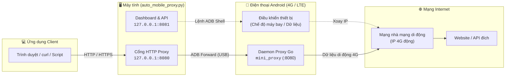

[ English ](README.md) · [ Tiếng Việt ](README.vi.md)

# 4G Mobile Proxy

[](LICENSE)
[](https://www.python.org/)
[](https://nodejs.org/)
[](#yêu-cầu)
[](#cách-hoạt-động)
[](#yêu-cầu)

> **Biến điện thoại Android 4G thành proxy HTTP luân chuyển IP hiệu năng cao trên máy tính qua ADB. Không cần APK, không cần root, kèm dashboard web cục bộ hiện đại.**

4G Mobile Proxy biến một chiếc điện thoại Android thông thường có SIM 4G/LTE thành proxy HTTP cho máy tính. Toàn bộ điện thoại được điều khiển qua ADB: một daemon Go nhỏ được sao chép vào `/data/local/tmp`, forward cổng ADB đưa nó ra `127.0.0.1:8080`, và một dịch vụ Python cung cấp dashboard web cục bộ tại `127.0.0.1:8081` để theo dõi, xoay IP và quản lý thiết bị.

Dashboard và nhật ký backend hỗ trợ đầy đủ hai ngôn ngữ Anh và Việt, mặc định là tiếng Anh.

## Mục lục

- [Tính năng](#tính-năng)
- [Cách hoạt động](#cách-hoạt-động)
- [Yêu cầu](#yêu-cầu)
- [Bắt đầu nhanh](#bắt-đầu-nhanh)
- [Chế độ demo](#chế-độ-demo)
- [Tùy chọn dòng lệnh](#tùy-chọn-dòng-lệnh)
- [Lệnh console](#lệnh-console)
- [Dashboard](#dashboard)
- [REST API](#rest-api)
- [Cấu hình và dữ liệu](#cấu-hình-và-dữ-liệu)
- [Cấu trúc dự án](#cấu-trúc-dự-án)
- [Phát triển](#phát-triển)
- [Kiểm thử](#kiểm-thử)
- [Xử lý sự cố](#xử-lý-sự-cố)
- [Bảo mật](#bảo-mật)
- [Đóng góp](#đóng-góp)
- [Giấy phép](#giấy-phép)

## Tính năng

- **Không APK, không cần root.** Daemon proxy là binary Go tĩnh được đẩy tới `/data/local/tmp/mini_proxy`; không cài ứng dụng nào lên Android. Root là tùy chọn và chỉ cần để ngắt sạc ở mức phần cứng.
- **Proxy HTTP luân chuyển IP.** Hỗ trợ HTTP thường và HTTPS qua `CONNECT`, với resolver chạy trên điện thoại để truy vấn DNS đi qua mạng di động.
- **Xoay thủ công hoặc theo lịch.** Xoay theo yêu cầu, hoặc tự động mỗi 2–1440 phút bằng chế độ máy bay hoặc bật/tắt dữ liệu di động.
- **Giám sát mạng trực tiếp.** IP công khai, nhà mạng, thành phố/tỉnh/quốc gia, độ trễ và tiến trình xoay theo từng bước.
- **Dashboard cục bộ hiện đại.** Năm trang responsive, xây dựng bằng React 19, TypeScript, Vite 7 và Tailwind CSS v4.
- **Giao diện Anh và Việt.** Nút chuyển ngôn ngữ bằng cờ trên topbar (và trong menu thao tác nhanh trên mobile) lưu lựa chọn vào `settings.json`. Nhật ký backend cũng được bản địa hóa.
- **Theo dõi dung lượng 4G.** Đọc bộ đếm lưu lượng trên điện thoại, cộng dồn theo ngày và cảnh báo khi chạm giới hạn dung lượng cấu hình.
- **Bảo vệ pin và nhiệt độ.** Hiển thị mức pin, nhiệt độ, tình trạng pin, điện áp và trạng thái sạc. Tự động tạm dừng sạc ở nhiệt độ nguy hiểm (root cho phép ngắt sạc ở mức phần cứng).
- **Lịch sử và nhật ký cục bộ.** Lưu 100 lần xoay và 500 dòng nhật ký gần nhất trong `data/` (đã gitignore).
- **Chế độ demo.** Khám phá toàn bộ dashboard với thiết bị và IP mô phỏng, không cần điện thoại.
- **Bảo mật ưu tiên loopback.** Dashboard mặc định bind `127.0.0.1`, gửi CSP nghiêm ngặt và giữ cài đặt cùng lịch sử trên máy của bạn.

## Cách hoạt động



1. Ứng dụng Python phát hiện điện thoại bằng `adb devices`.
2. Ứng dụng chọn daemon ARM32 hoặc ARM64 phù hợp trong `backend/bin/` và đẩy tới `/data/local/tmp/mini_proxy`.
3. Daemon khởi động trên điện thoại, và `adb forward` ánh xạ cổng `8080` trên máy tính tới cùng cổng trên thiết bị.
4. Các ứng dụng trên máy tính gửi lưu lượng tới `127.0.0.1:8080`; daemon chuyển tiếp qua kết nối 4G/LTE của điện thoại.
5. Để xoay IP, dịch vụ bật/tắt chế độ máy bay hoặc dữ liệu di động, chờ nhà mạng kết nối lại và kiểm tra IP công khai mới.
6. Dashboard và JSON API tại `127.0.0.1:8081` điều khiển thiết bị và hiển thị trạng thái trực tiếp.

## Yêu cầu

| Thành phần | Yêu cầu |
| --- | --- |
| Hệ điều hành | Windows 10/11, macOS 12+ hoặc Linux (Ubuntu, Debian, Fedora,...) |
| Python | **3.11+** kèm `pip` |
| Node.js | **20+** kèm npm (chỉ cần khi build hoặc phát triển dashboard) |
| Android Platform Tools | `adb` có trong `PATH` (hoặc tự phát hiện trong thư mục SDK chuẩn) |
| Điện thoại | Thiết bị Android đã bật gỡ lỗi USB, có cáp USB và SIM 4G/LTE đang hoạt động |
| Root | **Không bắt buộc.** Tùy chọn khi muốn ngắt sạc ở mức phần cứng |

### Lưu ý theo hệ điều hành & Cài đặt ADB

- **Windows:** Tải Android Platform Tools hoặc cài qua Android Studio. Nếu không nhận thiết bị, hãy cài OEM / Google USB Driver trong Device Manager.
- **macOS:** Cài qua Homebrew: `brew install android-platform-tools`. *Lưu ý:* Hãy thoát các ứng dụng truyền file như *Android File Transfer*, *Samsung Smart Switch*, hoặc *OpenMTP* vì chúng chiếm giữ cổng USB.
- **Linux:** Cài qua trình quản lý gói: `sudo apt install adb android-sdk-platform-tools-common`. Thêm người dùng vào nhóm `plugdev` (`sudo usermod -aG plugdev $USER`) và cắm lại cáp USB để tránh lỗi quyền `no permissions`.

Cài đặt thư viện Python:

```bash
python -m pip install -r requirements.txt
```

> Dashboard được phục vụ từ `frontend/dist`, thư mục này không được commit. Hãy build một lần sau khi clone (xem [Bắt đầu nhanh](#bắt-đầu-nhanh)).

## Bắt đầu nhanh

### 1. Clone kho lưu trữ

```bash
git clone https://github.com/dznpev/Proxy-4GMobile.git
cd Proxy-4GMobile
python -m pip install -r requirements.txt
```

### 2. Chuẩn bị điện thoại

1. Bật **Tùy chọn nhà phát triển** (nhấn **Số bản dựng** bảy lần trong **Giới thiệu điện thoại**).
2. Bật **Gỡ lỗi USB**.
3. Kết nối điện thoại bằng USB và chấp nhận hộp thoại **Cho phép gỡ lỗi USB**. Chọn **Luôn cho phép từ máy tính này** để thuận tiện.
4. Kiểm tra kết nối:

```bash
adb devices
# Điện thoại phải hiện trạng thái "device", không phải "unauthorized" hay "offline".
```

### 3. Build dashboard

```bash
cd frontend
npm install
npm run build
cd ..
```

### 4. Chạy ứng dụng

```bash
python auto_mobile_proxy.py --open
```

- Dashboard: **http://127.0.0.1:8081**
- Proxy HTTP: **http://127.0.0.1:8080**

Trỏ trình duyệt, hệ điều hành hoặc công cụ của bạn vào proxy và kiểm tra IP đầu ra:

```bash
curl -x http://127.0.0.1:8080 https://api.ipify.org
```

Lần chạy đầu tiên, ứng dụng sẽ phát hiện điện thoại, khởi động daemon và mở phiên proxy. Dùng dashboard để xoay IP, đổi cài đặt hoặc xem thông tin thiết bị.

## Chế độ demo

Chế độ demo mô phỏng thiết bị đã kết nối, IP công khai, tiến trình xoay, dữ liệu pin và nhật ký. Phù hợp để phát triển giao diện, chụp ảnh màn hình và thử quy trình mà không cần điện thoại Android:

```bash
python auto_mobile_proxy.py --demo --open
```

Dashboard vẫn ở `http://127.0.0.1:8081`, trạng thái demo được đánh dấu rõ trong giao diện và `/api/health`.

## Tùy chọn dòng lệnh

| Tùy chọn | Mặc định | Mô tả |
| --- | --- | --- |
| `--demo` | tắt | Mô phỏng thiết bị, IP và tiến trình xoay. |
| `--proxy-port` | `8080` | Cổng proxy HTTP cục bộ. |
| `--control-port` | `8081` | Cổng dashboard và JSON API. |
| `--host` | `127.0.0.1` | Địa chỉ bind dashboard. Chỉ đổi khi hiểu rõ rủi ro bảo mật. |
| `--adb` | `adb` | Đường dẫn tới file thực thi ADB. |
| `--data-dir` | `data/` | Thư mục lưu `settings.json`, `history.json` và `usage.json`. |
| `--headless` | tắt | Không đọc lệnh bàn phím; chỉ chạy dashboard và dịch vụ nền. |
| `--open` | tắt | Tự mở dashboard trong trình duyệt mặc định. |
| `--version` | - | In phiên bản ứng dụng rồi thoát. |

Có thể cấu hình bằng biến môi trường:

| Biến | Mặc định | Mô tả |
| --- | --- | --- |
| `PROXY_HTTP_PORT` | `8080` | Cổng proxy HTTP cục bộ. |
| `PROXY_CONTROL_PORT` | `8081` | Cổng dashboard và API. |
| `PROXY_CONTROL_HOST` | `127.0.0.1` | Địa chỉ bind dashboard. |
| `PROXY_DATA_DIR` | `data/` | Thư mục dữ liệu. |
| `PROXY_ADB` | `adb` | Đường dẫn tới file thực thi ADB. |

Cờ dòng lệnh có độ ưu tiên cao hơn biến môi trường.

## Lệnh console

Khi chạy tương tác (không có `--headless`):

| Lệnh | Tác dụng |
| --- | --- |
| `r` | Bắt đầu xoay IP. |
| `c` | Kiểm tra lại kết nối và IP công khai. |
| `h` hoặc `?` | Hiển thị trợ giúp. |
| `q` | Thoát và dọn daemon trên điện thoại. |

## Dashboard

| Trang | Nội dung |
| --- | --- |
| **Tổng quan** | Trạng thái phiên, IP hiện tại và nhà mạng, tiến trình xoay, thống kê sử dụng, lịch sử và nhật ký gần đây. |
| **Thiết bị** | Serial, model, phiên bản Android, kiến trúc, trạng thái root, ADB, daemon, forward cổng, pin và nhiệt độ, kết nối lại và khởi động lại daemon. |
| **Lịch sử IP** | Bảng đầy đủ các lần xoay với bộ lọc thành công/thất bại, thời gian, IP cũ/mới, nhà mạng, vị trí, thời lượng và thao tác xóa lịch sử. |
| **Nhật ký** | 500 dòng nhật ký gần nhất với bộ lọc mức độ, tìm kiếm, tự cuộn và xóa nhật ký. |
| **Cài đặt** | Tự động xoay, chu kỳ, phương thức xoay, giới hạn dung lượng 4G hàng ngày, ngôn ngữ hiển thị, thông tin API và thư mục dữ liệu. |

Giao diện dùng hash routing (`#/overview`, `#/device`, `#/history`, `#/logs`, `#/settings`) nên hoạt động khi phục vụ từ bản build tĩnh cục bộ.

### Chuyển ngôn ngữ

Dùng nút cờ trên topbar (hoặc menu thao tác nhanh trên mobile) để chuyển giữa **English (cờ Mỹ)** và **Tiếng Việt (cờ Việt Nam)**. Lựa chọn được lưu trong `data/settings.json` ở khóa `language` và được khôi phục ở lần chạy sau. Nhật ký backend mới sẽ được ghi bằng ngôn ngữ đang chọn; lịch sử cũ giữ nguyên nội dung đã ghi.

## REST API

Dashboard và API mặc định lắng nghe trên `127.0.0.1:8081`. **Không có xác thực**; hãy giữ cổng này trên loopback hoặc đặt sau reverse proxy tin cậy.

| Phương thức | Đường dẫn | Mô tả |
| --- | --- | --- |
| `GET` | `/api/status` | Toàn bộ trạng thái dashboard: ứng dụng, thiết bị, proxy, mạng, dung lượng, tiến trình xoay, cài đặt và thống kê. |
| `GET` | `/api/logs?after=<id>&limit=<n>` | Nhật ký tăng dần. `limit` được giới hạn trong khoảng 1–500. |
| `GET` | `/api/history` | Lịch sử xoay và thống kê tổng hợp. |
| `GET` | `/api/settings` | Cài đặt hiện tại và các giá trị hợp lệ. |
| `GET` | `/api/health` | Kiểm tra nhanh tên ứng dụng, phiên bản và cờ demo. |
| `POST` | `/api/rotate` | Bắt đầu xoay IP. Trả `202` ngay. |
| `POST` | `/api/check` | Kiểm tra lại kết nối và IP công khai qua proxy. |
| `POST` / `PATCH` | `/api/settings` | Cập nhật cài đặt. Chấp nhận object cài đặt một phần. |
| `POST` | `/api/history/clear` | Xóa lịch sử xoay. |
| `POST` | `/api/logs/clear` | Xóa nhật ký sự kiện. |
| `POST` | `/api/usage/reset` | Đặt lại bộ đếm dung lượng hôm nay. |
| `POST` | `/api/device/reconnect` | Kết nối lại thiết bị Android. Trả `202`. |
| `POST` | `/api/device/battery/charge` | Bật hoặc tạm dừng sạc: `{"enabled": true}`. |
| `POST` | `/api/proxy/restart` | Khởi động lại daemon proxy. Trả `202`. |

Ví dụ:

```bash
# Trạng thái hiện tại
curl http://127.0.0.1:8081/api/status

# Xoay IP
curl -X POST http://127.0.0.1:8081/api/rotate

# Chuyển dashboard và nhật ký mới sang tiếng Việt
curl -X PATCH http://127.0.0.1:8081/api/settings \
  -H "Content-Type: application/json" \
  -d '{"language": "vi"}'

# Kiểm tra IP đầu ra qua proxy
curl -x http://127.0.0.1:8080 https://api.ipify.org
```

Lỗi luôn có cùng cấu trúc:

```json
{
  "ok": false,
  "error": {
    "code": "validation_error",
    "message": "Ngôn ngữ không hợp lệ."
  }
}
```

## Cấu hình và dữ liệu

Dữ liệu chạy mặc định nằm trong `data/` và được loại khỏi Git.

| File | Nội dung |
| --- | --- |
| `data/settings.json` | `auto_rotate_enabled`, `auto_rotate_interval_min` (2–1440), `rotate_method` (`airplane` hoặc `data`), `daily_data_limit_gb` (0–1000; `0` là không giới hạn), `language` (`en` hoặc `vi`). |
| `data/history.json` | Tối đa 100 bản ghi xoay, mới nhất trước. |
| `data/usage.json` | Bộ đếm lưu lượng di động theo ngày (RX, TX, tổng byte). |

- Xoay tự động chỉ chạy khi thiết bị đang kết nối. Sau mỗi lần xoay, lần tiếp theo được tính lại theo chu kỳ đã cấu hình.
- File cài đặt cũ không có `language` sẽ mặc định an toàn về `en`.
- Đổi vị trí dữ liệu bằng `--data-dir` hoặc `PROXY_DATA_DIR`.

## Cấu trúc dự án

```text
auto_mobile_proxy.py           # Điểm vào CLI và vòng đời ứng dụng
backend/
  mobile_proxy/
    config.py                  # Cấu hình, đường dẫn, biến môi trường
    events.py                  # Nhật ký sự kiện trong bộ nhớ có giới hạn
    adb.py                     # Wrapper ADB (thiết bị, shell, push, forward, pin)
    network.py                 # Tra cứu IP công khai qua proxy
    storage.py                 # Lưu cài đặt, lịch sử và dung lượng
    demo.py                    # Backend mô phỏng cho chế độ demo
    i18n.py                    # Danh mục thông điệp backend Anh/Việt
    service.py                 # Vòng đời thiết bị, xoay IP, lịch, pin
    server.py                  # HTTP server, JSON API, file tĩnh, CSP
  proxy_daemon/main.go         # Mã nguồn daemon proxy Go
  bin/
    proxy_arm32.bin            # Daemon ARM32 dựng sẵn
    proxy_arm64.bin            # Daemon ARM64 dựng sẵn
  tests/                       # unittest/pytest cho storage, service, API
frontend/
  index.html                   # Điểm vào Vite
  src/main.tsx                 # Khởi tạo React
  src/app/                     # Router, shell, provider, hook
  src/components/              # Layout và component UI dùng chung
  src/pages/                   # Năm trang dashboard
  src/locales/en.ts            # Danh mục tiếng Anh (nguồn chuẩn)
  src/locales/vi.ts            # Danh mục tiếng Việt, kiểu dựa trên en.ts
  src/api/                     # Client API và kiểu TypeScript
  src/lib/                     # Hằng số, format, trạng thái, i18n
  src/styles/                  # Token thiết kế, layout, component, responsive
  public/assets/fonts/         # Be Vietnam Pro tự lưu và giấy phép OFL
  dist/                        # Bản build production (đã gitignore)
README.md                      # Tài liệu tiếng Anh
README.vi.md                   # Tài liệu tiếng Việt
LICENSE                        # Giấy phép MIT
requirements.txt               # Thư viện Python
```

## Phát triển

### Backend

Chạy backend ở chế độ demo trong lúc phát triển giao diện:

```bash
python auto_mobile_proxy.py --demo
```

### Frontend

Mở terminal thứ hai:

```bash
cd frontend
npm install
npm run dev
```

Mở **http://127.0.0.1:5173**. Vite proxy các request `/api` sang backend tại `127.0.0.1:8081`.

Các lệnh hữu ích:

```bash
npm run typecheck   # Kiểm tra kiểu TypeScript
npm run build       # Kiểm tra kiểu và build production vào frontend/dist
npm run preview     # Xem trước bản build production
```

Hệ thống i18n không phụ thuộc thư viện ngoài: `en.ts` là nguồn chuẩn, `vi.ts` được định kiểu là `typeof en`, và `I18nProvider` cung cấp `locale`, `setLocale` và `t`. Thêm khóa vào một danh mục mà thiếu ở danh mục kia sẽ làm typecheck thất bại.

## Kiểm thử

Test backend dùng backend demo, không cần điện thoại hay mạng ngoài:

```bash
python -m unittest discover -s backend/tests -v
# hoặc
python -m pytest backend/tests -v
```

Kiểm tra thêm:

```bash
python -m compileall -q auto_mobile_proxy.py backend
cd frontend
npm run typecheck
npm run build
```

## Xử lý sự cố

| Hiện tượng | Cách khắc phục |
| --- | --- |
| Không tìm thấy `adb` | Cài Android Platform Tools và thêm thư mục chứa `adb` vào `PATH`, hoặc truyền `--adb <đường-dẫn>`. |
| Thiết bị báo `unauthorized` | Mở khóa điện thoại, chấp nhận **Cho phép gỡ lỗi USB** và chọn **Luôn cho phép từ máy tính này**. |
| Thiết bị báo `offline` | Rút và cắm lại cáp USB, chạy `adb kill-server` rồi `adb devices`, hoặc dùng **Kết nối lại** trên trang Thiết bị. |
| Dashboard trắng hoặc trả 404 | Build frontend: `cd frontend && npm install && npm run build`. |
| Daemon proxy không chạy | Mở **Thiết bị** và bấm **Khởi động lại daemon**; nếu vẫn lỗi, bấm **Kết nối lại**. |
| Không có Internet sau khi xoay | Kiểm tra Wi-Fi đã tắt, chế độ máy bay đã tắt lại, SIM còn sóng và còn dung lượng. |
| Cổng đang bận | Đổi `--proxy-port` hoặc `--control-port`, hoặc dừng tiến trình đang dùng cổng. |
| Linux: `no permissions` với thiết bị | Cài `android-sdk-platform-tools-common` và chạy `sudo usermod -aG plugdev $USER`, sau đó cắm lại cáp USB. |
| macOS: thiết bị báo bận hoặc offline | Thoát các ứng dụng chạy ngầm như *Android File Transfer* hoặc *Samsung Smart Switch* đang giữ cổng USB. |
| Điện thoại nóng | Đặt nơi thoáng mát. Ứng dụng cảnh báo trên 40°C và tạm dừng sạc ở 45°C; root cho phép ngắt sạc phần cứng. |
| Đổi ngôn ngữ nhưng nhật ký cũ không đổi | Dòng nhật ký cũ được giữ nguyên. Sự kiện mới dùng ngôn ngữ đã chọn ngay lập tức. |

## Bảo mật

- Dashboard có thể điều khiển điện thoại và **không có đăng nhập**. Mặc định chỉ bind `127.0.0.1`.
- Nếu dùng `--host 0.0.0.0`, chỉ làm trong mạng tin cậy và bổ sung xác thực hoặc reverse proxy phía trước.
- Server gửi Content Security Policy nghiêm ngặt, `X-Frame-Options: DENY`, `X-Content-Type-Options: nosniff`, `Referrer-Policy: no-referrer` và các header tăng cường bảo mật khác.
- Không commit thư mục `data/`: thư mục này có thể chứa lịch sử IP, thông tin nhà mạng và cấu hình cá nhân.
- Proxy không có xác thực riêng. Chỉ bind loopback và tránh mở ra Internet.

## Đóng góp

Mọi đóng góp đều được hoan nghênh. Để dự án dễ bảo trì:

1. Fork kho lưu trữ và tạo nhánh tính năng từ `main` (ví dụ `feature/my-change`).
2. Tuân theo cấu trúc và phong cách hiện có. Giữ chuỗi giao diện đồng bộ ở cả `en.ts` và `vi.ts`.
3. Thêm hoặc cập nhật test cho mọi thay đổi hành vi backend.
4. Chạy test backend, typecheck và build production trước khi mở pull request.
5. Dùng [Conventional Commits](https://www.conventionalcommits.org/), ví dụ `feat(frontend): add ...`, `fix(backend): ...` hoặc `docs: ...`.
6. Mô tả động lực, thay đổi hành vi và các bước kiểm chứng trong pull request.

Vui lòng không commit các file sinh tự động như `frontend/dist/`, `frontend/node_modules/`, `data/` hay `__pycache__/`.

## Giấy phép

Phát hành theo [Giấy phép MIT](LICENSE).

Bản quyền (c) 2026 dznpev.

